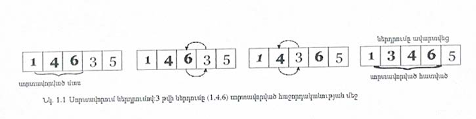
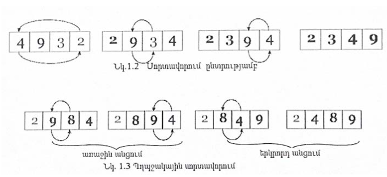
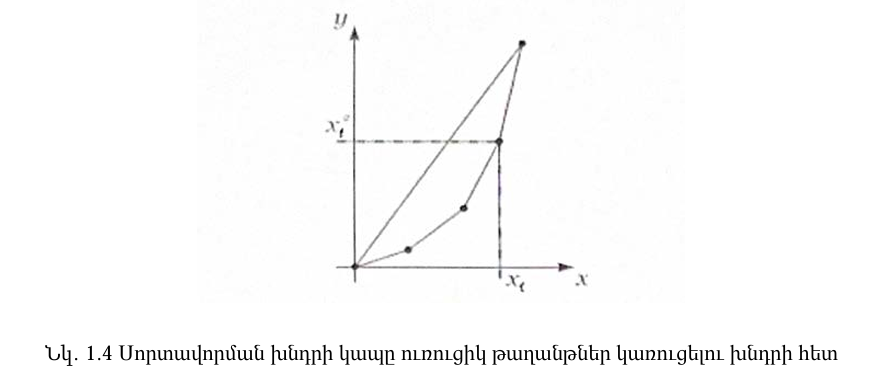
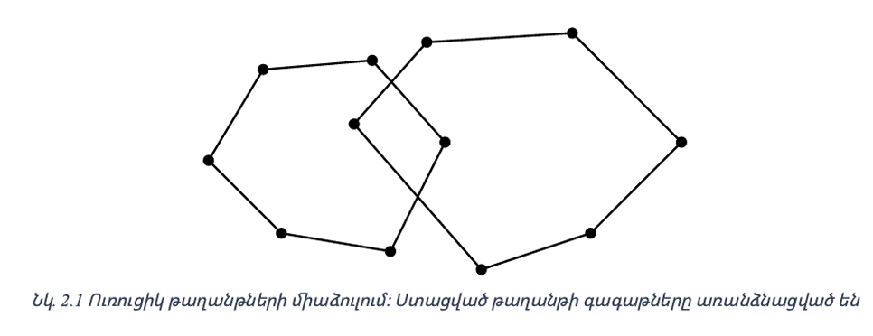
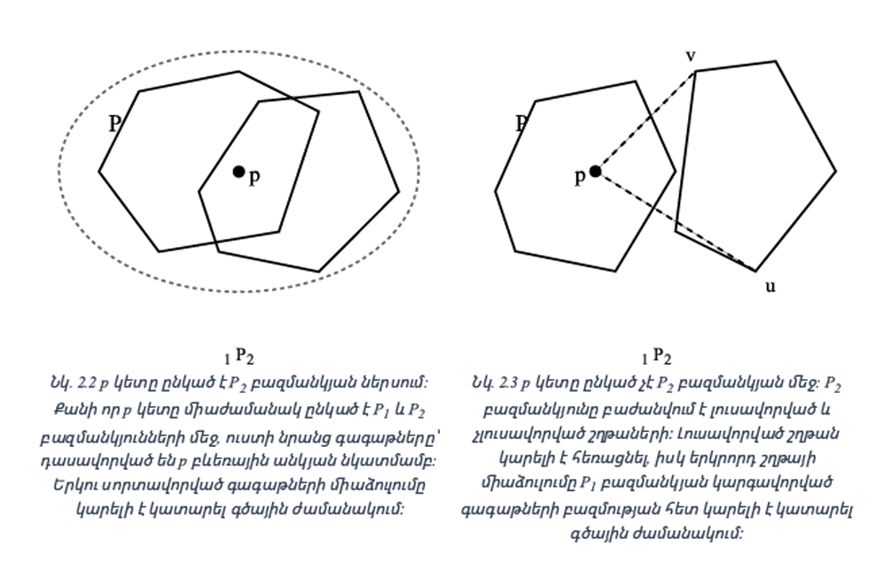
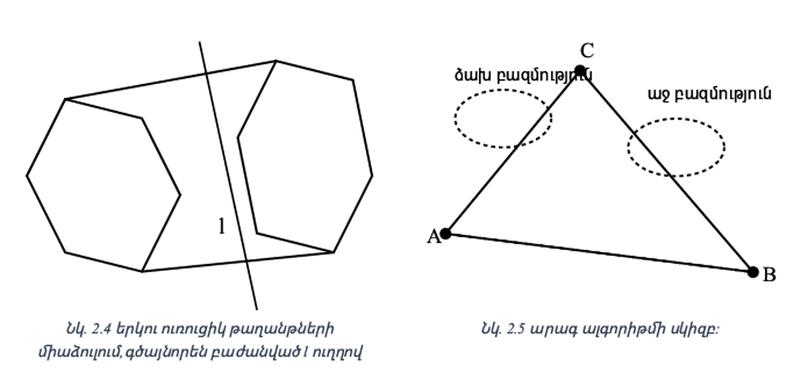
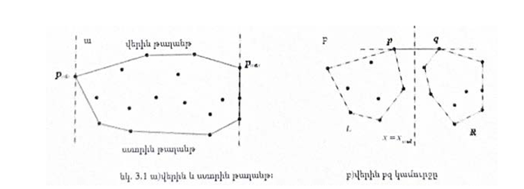

## Ներածություն

Համակարգչային երկրաչափությունը հանդիսանում է ժամանակակից կիրառական մաթեմատիկայի և ինֆորմատիկայի հիմնական բաժիններից մեկը: Այն թույլ է տալիս կառուցել տարբեր երկրաչափական օբյեկտների թվային մոդելները, ինչպես նաև ստանալ դեռևս գոյություն չունեցող օբյեկտների պատկերները, ուսումնասիրել այդ օբյեկտների երկրաչափական և ֆիզիկական հատկությունները: Ավարտական աշխատանքը նվիրված է հաշվողական երկրաչափության կարևոր խնդիրներից մեկին՝ ուռուցիկ թաղանթների կառուցման օպտիմալ ալգորիթմներին: Առաջին գլխում դիտարկվող ուռուցիկ թաղանթների կառուցման բոլոր ալգորիթմները, որպես խնդրի պատասխան, տալիս են ուռուցիկ թաղանթի ծայրակետերի կարգավորված հաջորդականություն: Խնդրի նման քննարկումը, բնականաբար, կապվում է սորտավորման խնդրի հետ: Իսկապես, ծայրակետերի կարգավորված հաջորդականություն ստանալու անհրաժեշտությունը պահանջում է ալգորիթմից սորտավորում կատարելու հնարավորություն: Ակնհայտ է տեսակավորման խնդրի և Գրեհեմի ալգորիթմի կապը, որը սկսվում է նրանից, որ կարգավորում է բևեռային անկյունում գտնվող կետերի նախնական բազմությունը: Նախքան ուռուցիկ բազմանկյունների կառուցման այլ ալգորիթմներ վերլուծելը, հիշենք հիմնական ալգորիթմները, որոնք լուծում են սորտավորման խնդիրը: Սորտավորման ալգորիթմը դա ալգորիթմ է, տվյալ բազմության էլեմենտները՝ որոշակի կարգի հարաբերակցությամբ կարգավորելու համար: Կարելի է առանձնացնել սորտավորման երեք հիմնական մեթոդ: Դրանք են՝ սորտավորում ներդրումով (insertion sort), սորտավորում ընտրությամբ (selection sort) և սորտավորում փոխանակումով: Ավարտական աշխատանքի երկրորդ գլուխը նվիրված է ուռուցիկ թաղանթների կառուցման օպտիմալ ալգորիթմներին եռաչափ տարածությունում:

**ԳԼՈՒԽ 1. Ուռուցիկ թաղանթների կառուցման օպտիմալ ալգորիթմներ**

### 1.1. Ուռուցիկ թաղանթների կառուցման խնդրի կապը սորտավորման խնդիրների հետ

Ներդրումով սորտավորման մեթոդի գաղափարը հետևյալն է։ Ալգորիթմի յուրաքանչյուր փուլում ընտրվում է մուտքագրված տարրերից մեկը և տեղադրվում հաջորդականության նախկինում սորտավորված մասում, այդպիսի քայլերը կրկնվում են մինչև մուտքի տվյալների սպառումը (նկ. 1.1)։ Այս սորտավորման ալգորիթմի բարդությունը $O(n^2)$ է։

  

Ընտրությամբ սորտավորման ալգորիթմի գաղափարը կայանում է նրանում, որ ամեն քայլափոխի փնտրեք դեռ չկարգավորված տարրերից ամենափոքրը (ընդ որում, նախկինում՝ կարգավորված տարրերից յուրաքանչյուրը ակնհայտորեն պակաս է դեռ չկարգավորված տարրերից յուրաքանչյուրից) և տեղափոխեք այն կարգավորված մասի ավարտին (նկ. 1.2)։ Ընտրությամբ տեսակավորման ալգորիթմի բարդությունը $n$ տարրերի համար՝ $O(n^2)$ է։ Ընտրությամբ տեսակավորման կատարելագործված տեսակը, որը հայտնի է որպես բրգաձև տեսակավորում (Heap sort), ունի $O(n \log n)$ բարդություն։ 

Փոխանակման սորտավորումը բազմիցս օգտագործում է համեմատություններ և, եթե պահանջվում է, կատարում է ընտրված տարրերի զույգի տեղափոխում։ Հարցն այն է, թե որ զույգերն են և ինչ կարգով են ընտրվում համեմատության և վերադասավորումների համար։ Պարզ փոխանակման տեսակավորումը ("Bubble sort") հերթականությամբ համեմատում է հարակից զույգ տարրերը։ Հաջորդականության մեկ անցման ժամանակ զույգի ավելի մեծ տարրը շարժվում է դեպի հաջորդականության վերջ մինչև իր հերթին չհանդիպի ավելի մեծ տարրի, որը շարունակելու է առաջ շարժվել։ Մի քանի նման անցումներից հետո հաջորդականությունը կանոնակարգվում է (նկ. 1.3)։ Պղպջակավոր տեսակավորման ալգորիթմի բարդությունը $O(n^2)$ է։

  

Կատարելագործված փոխանակման սորտավորման ալգորիթմը, որը հայտնի է որպես «արագ տեսակավորում» (Quick sort), վատագույն դեպքում ունի $O(n^2)$ բարդություն, սակայն միջին հաշվով միայն $O(n \log n)$։ Գործնականում արագ տեսակավորումն աշխատում է զգալիորեն ավելի արագ, քան $O(n \log n)$ բարդությամբ այլ ալգորիթմները։ Ալգորիթմի գաղափարն այն է, որ տվյալների սկզբնական հավաքածուն բաժանվի երկու հարակից մասերի, այնպես որ առաջին մասի ցանկացած տարրը կարգավորված է երկրորդ մասի ցանկացած տարրի հետ համեմատած։ Այնուհետև ալգորիթմը ռեկուրսիվ ձևով կիրառվում է յուրաքանչյուր մասի համար։ 

Եվս երկու մեթոդ կարելի է դիտարկել որպես ներդրումով տեսակավորման ալգորիթմի ամփոփում։ Առաջինը տեսակավորումն է միաձուլումով (Merge sort)։ Այս ալգորիթմի հիմնական գաղափարն այն է, որ բազմությունը տրոհվում է երկու ենթաբազմության մոտավորապես հավասար հզորությամբ, ռեկուրսիվ ձևով դասավորվում է նրանցից յուրաքանչյուրը, ապա ենթաբազմությունները միավորվում են արդյունքների (միավորվելիս հասկանում ենք առաջին կարգավորված բազմության տարրերի ներդրումը երկրորդի մեջ)։ $n$ տարրերի համար միաձուլման տեսակավորման ընդհանուր ժամանակը $O(n \log n)$ է։ Մենք կարող ենք օգտագործել երկուական որոնման ծառը, տեսակավորումը կոչվում է երկուական ծառի տեսակավորում (Binary tree sort)։ Դրա համար դատարկ ծառի մեջ հերթականությամբ ավելացվում են բազմության բոլոր էլեմենտները և հետո կատարվում է ծառի սիմետրիկ շրջանցում բոլոր էլեմենտների ծառից դուրս բերումով՝ ըստ իրենց կարգի։ Տեսակավորման աշխատանքի ժամանակը կախված է որոնման երկուական ծառի իրականացումից և հավասարակշռված որոնման ծառի օգտագործման դեպքում կազմում է $O(n \log n)$։ Քանի որ բոլոր նշված տեսակավորման ալգորիթմները ուիվերսալ են, այսինքն օգտագործում են միայն տարրերի զույգի համեմատություններ հաշվի չառնելով դրանց ներքին կառուցվածքի առանձնահատկությունները, ապա, մուտքագրելով համապատասխան ձևական մոդել (լուծումների ծառեր), կարելի է ցույց տալ, որ վատագույն դեպքում ցանկացած նման տեսակավորում պահանջում է $\Omega(n \log n)$ ժամանակ։ Եկեք խոսենք ուռուցիկ թաղանթներ կառուցելու խնդրի և սորտավորման խնդիրների կապի մասին։ Հարկ է նշել, որ կապը կլինի ավելի խիստ և ամբողջական, եթե սկզբնական բազմության բոլոր կետերը լինեն ուռուցիկ թաղանթի գագաթներ։ Դա միանգամայն հասկանալի է, քանի որ տեսակավորման խնդրում չկա նմանություն ուռուցիկ թաղանթի ներքին կետերի համար, որոնք, ի վերջո, չեն ընդգրկվում արդյունքի մեջ։ Այսպիսով, հիշենք $\{p_i\}_i^n$ կետերի համար Ջարվիսի շրջանցման ալգորիթմի հիմնական քայլերը։

1. Գտնել ակնհայտ ծայրահեղ կետը $p_{start}$, տեղադրել $p_{current} \leftarrow p_{start}$։
2. Գտնել $p_{next}$ կետը, անմիջապես $p_{current}$ կետից հետո ուռուցիկ թաղանթի շրջանցելու ժամանակ։
3. Նմանապես գտնել ուռուցիկ թաղանթի բոլոր գագաթները, ամեն քայլափոխի հենվելով $p_{current}$ կետի վրա։

Պարզ է, որ Ջարվիսի ալգորիթմը համապատասխանում է ընտրության մեթոդով տեսակավորմանը՝ ամեն քայլափոխի ընտրվում է ինչ-որ առումով ամենափոքր կետը, և ավելացվել է ուռուցիկ թաղանթին։ Ինչպես նշված էր ավելի վաղ, $n$ տարրերը տեսակավորելու համար, ընդհանուր առմամբ, պահանջվում է առնվազն $\Omega(n \log n)$ գործողություն կամ, այլ կերպ ասած, ցանկացած տեսակավորման ալգորիթմի համար կարելի է ներկայացնել այնպիսի մուտքային տվյալներ, որ դրա կիրառումը կպահանջի առնվազն $\Omega(n \log n)$ գործողություններ։ Այս առումով ասում են, որ սորտավորման խնդրի ստորին սահմանը հավասար է $\Omega(n \log n)$-ի։ Արդյոք հնարավոր է գտնել ուռուցիկ թաղանթներ կառուցելու խնդրի ստորին սահմանը։ Պարզվում է, որ կարելի է, և միաժամանակ էապես օգտագործվում է այդ խնդրի կապը տեսակավորման խնդրի հետ։ Դրա համար կօգտագործենք այսպես կոչված տեսակավորման խնդրի վերափոխումը ուռուցիկ թաղանթների կառուցման խնդրին։ Սահմանենք խնդիրների փոխակերպման կարգը։ Ենթադրենք կան երկու A և B խնդիրները, որոնք կապված են այնպես, որ խնդիր A-ն կարող է լուծվել հետևյալ կերպ.

1. A առաջադրանքի ելակետային տվյալներից նախագծել համապատասխան ելակետային տվյալներ B առաջադրանքի համար։
2. Լուծել B խնդիրը։
3. B խնդրի լուծման արդյունքից ստանալ A խնդրի լուծման արդյունքը։

Այդ դեպքում կասենք, որ A խնդիրը ձևափոխելի է B խնդրի։ Տեսակավորման խնդրի ձևափոխումը ուռուցիկ թաղանթների կառուցման խնդրի հիման վրա ստանանք ուռուցիկ թաղանթների կառուցման ժամանակի ստորին սահմանը։ Դրա համար դիտարկենք $\{x_i\}_i^n$ բնական թվերի սորտավորման խնդիրը։ Հայտնի է, որ այս խնդիրը չի կարող լուծվել ավելի արագ, քան $\Omega(n \log n)$։ Դիտարկենք $Q = \{(x_i, y_i\}_i^n$ հարթության վրա հաջորդականության փոխադարձաբար պարզ ձևափոխություն (տեսակավորման խնդրի մուտքային տվյալների) $\{x_i\}_i^n$ կետերի բազմության (ուռուցիկ թաղանթներ) կառուցելու խնդրի մուտքային տվյալների։ Յուրաքանչյուր $x_i$ տարր համապատասխանեցնենք $\{(x_i, x_i^2)\}$ տարրի (Նկ. 1.4):

  

Ապա լուծենք Q բազմության էլեմենտներով ուռուցիկ թաղանթ կառուցելու խնդիրը որոշակի T(n) ժամանակում։ Արդյունքում $y = x^2$ ֆունկցիայով կառուցված թաղանթը կլինի ուռուցիկ և բաղկացած կլինի Q բազմության բոլոր կետերից։ Ուռուցիկ թաղանթի գագաթների մի դիտարկում թույլ է տալիս կարդալ 3 գագաթները ճիշտ հերթականությամբ (դրա համար անհրաժեշտ է գտնել ամենափոքր աբսցիսն ունեցող կետը և նրանից սկսած ժամացույցի հակառակ ուղղությամբ կարդալ մնացած բոլոր կետերը)։ Այսպիսով, ընդհանուր տվյալների փոխակերպման ժամանակը խնդիրների միջև հավասար է $O(n)$։ Մյուս կողմից, մենք գիտենք, որ տեսակավորման խնդիրը չի կարող լուծվել ավելի արագ, քան $\Omega(n \log n)$ քայլերի միջոցով։ Ամբողջացնելով վերջն ասվածը, մենք ստանում ենք՝ $\Omega(n \log n) \le O(n) + T(n)$։ Այստեղից հետևում է, որ ուռուցիկ թաղանթ կառուցելու ժամանակի ստորին սահմանը $\Omega(n \log n)$ է։ Ինչպես տեսնում ենք, Գրեհեմի ալգորիթմը հասնում է ուռուցիկ թաղանթ կառուցելու ժամանակի ստորին սահմանին։ Հաշվի առնելով վերջին նշվածը, կարելի է վերադառնալ ուռուցիկ թաղանթի կառուցման քայլ առ քայլ ալգորիթմի քննարկմանը, որը ունի $O(n^2)$ բարդություն։ Հարց է առաջանում, թե արդյո՞ք հնարավոր է բարելավել այս ալգորիթմը մինչև ժամանակի ստորին սահմանը։ Խելամիտ է ենթադրել, որ նման արդյունքի կարելի է հասնել, եթե տեսակավորման խնդիրը իր հերթին կազատի իր ժամանակի ստորին սահմանին։ Երկուական ծառի մեթոդով տեսակավորումը լիովին բավարարում է առաջադրված պայմաններին։ Իսկապես, ներկայացնելով ուռուցիկ թաղանթի գագաթների հաջորդականությունը հավասարակշռված երկուական ծառի միջոցով, հիմնային կետերը կարելի է գտնել $O(n \log n)$ ժամանակում։ Այսպիսով, քայլ-առ քայլ եղանակով ուռուցիկ թաղանթ կառուցելու խնդիրը կարող է լուծվել $O(n \log n)$ ժամանակում։ Ստացված արդյունքը թույլ է տալիս ասել, որ իրականում ցանկացած ալգորիթմ, որ կառուցում է ուռուցիկ թաղանթի գագաթների կարգավորված հաջորդականությունը, անկախ իր կողմից իրականացվող մեթոդից, քողարկված տեսակավորման ալգորիթմ է։ Նշենք նաև, որ ուռուցիկ թաղանթի կառուցման խնդիրը վերածվում է տեսակավորման խնդրի (իրականում, այս փոխակերպումը կատարվում է Գրեհեմի ալգորիթմի կողմից)։ Հիշեցնենք, որ Ջարվիսի ալգորիթմը ունի $O(nh)$ բարդությունը որտեղ h-ը ուռուցիկ թաղանթի գագաթների թիվն է։ Ստին է հարցնել, թե ո՞րն է ալգորիթմի միջին աշխատանքային ժամանակը։ Իր հերթին, ալգորիթմի աշխատանքի միջին ժամանակը կախված է h-ի մեծության մաթեմատիկական սպասումից։ Պարզվում է, որ կետերի նորմալ բաշխման ժամանակ Jarvis-ի ալգորիթմը պահանջում է միջինում $O(n\sqrt{\log n})$ ժամանակ, որն ավելի քիչ է քան Գրեհեմի համար անհրաժեշտ ժամանակը։

## 1.2. Ուռուցիկ թաղանթների կառուցման այլ ալգորիթմներ

Մինչ այժմ դիտարկվել են բազմության կետերով ուռուցիկ թաղանթների կառուցման ալգորիթմներ, իսկ հետո դրանց նմանակներն էին տեսակավորման ալգորիթմներից։ Գործենք հակառակ ձևով։ Միավորումով տեսակավորման հայտնի ալգորիթմի ընդհանրացված տեսակը ուռուցիկ թաղանթների կառուցման ալգորիթմն է, որն օգտագործում է "բաժանիր և տիրիր" մեթոդը։ Ալգորիթմի էությունը հետևյալն է. Եթե տրված n կետերի թիվը փոքր է $n_0$ հաստատունից, առա ուռուցիկ թաղանթը կառուցվում է որոշակի ուղղակի մեթոդով (օրինակ, Jarvis ալգորիթմը)։ Եթե n-ն ավելի մեծ է 1-ից, ապա սկզբում n տարրերից բաղկացած բազմությունը կամայական կերպով բաժանվում են երկու ենթաբազմությունների, որոնք պարունակում են մոտավորապես n/2 կետ յուրաքանչյուրը։ Այնուհետև ռեկուրսիվ ձևով փնտրում ենք ուռուցիկ թաղանթներ այդ երկու ենթաբազմությունների համար։ n կետերից բաղկացած ուռուցիկ թաղանթի կառուցման համար անհրաժեշտ է իրականացնել միաձուլման քայլ, այսինքն միավորել արդեն կառուցված $P_1$ և $P_2$ ենթաբազմությունները $O(n)$ ժամանակում (Նկ. 2.1)։

  

Օգտագործելով միաձուլվող թաղանթների գագաթների կարգը, այս ընթացակարգը կարող է վերափոխվել Գրեհեմի շրջանցմանը։ Նկարագրենք $P_1$ և $P_2$ ուռուցիկ բազմանկյունների միավորման և ուռուցիկ թաղանթի կառուցման քայլերն ավելի մանրամասն.

1. Գտնել $P_1$ բազմանկյան որոշակի ներքին p կետ։ Նման գագաթը կարելի է վերցնել, օրինակ, $P_1$-ի կամայական երեք գագաթների կենտրոն։ Այս ձևով ընտրված p կետը կլինի $CH(P_1 \cup P_2)$-ի ներքին կետ (Նկ. 2.2)։
2. Որոշել, թե արդյոք p կետը $P_2$-ի ներքին կետ է թե ոչ։ Դա կարելի է կատարել գծային ժամանակում $P_2$-ի գագաթների քանակից կախված (p կետը ուռուցիկ P բազմանկյան ներքին կետ է, եթե P-ն շրջանցելով ժամացույցի սլաքի հակառակ ուղղությամբ, p կետը ամբողջ ժամանակ ընկած կլինի բազմանկյան գագաթներից ձախ)։ Եթե p-ն $P_2$-ի ներքին կետ չէ անցնել 4-րդ քայլին։
3. p-ն $P_2$-ի ներքին կետ է։ $P_1$ և $P_2$ գագաթները P կետի բևեռային անկյան նկատմամբ, լինում են կարգավորված։ $O(n)$ ժամանակի ընթացքում կարելի է ձեռք բերել ինչպես $P_1$-ի, այնպես էլ $P_2$-ի գագաթների կարգավորված ցուցակը, այդ բազմանկյունների գագաթների բազմության միաձուլման միջոցով (Նմանապես, ինչպես mergesort տեսակավորման ժամանակ, երբ երկու տեսակավորված զանգվածները միաձուլվում են մեկի մեջ)։ Անցնել 5 քայլին։

4. p-ն $P_2$ ներքին կետ չէ (Նկ. 2.3)։ Այնպես ինչպես քայլ առ քայլ ալգորիթմի ժամանակ պատկերացնենք, որ p կետում լույսի կետային աղբյուր է։ Այնուհետև $P_2$ սահմանը կտրونوհվի լուսավորված և չլուսավորված շղթայով հատվածների։ Ակնհայտ է, որ լուսավորված շղթայի գագաթները կարող են հեռացվել, քանի որ դրանք կլինեն $CH(P_1 \cup P_2)$ ներքին կետերը։ $P_2$-ի մնացած (ստվերում) շղթան (սահմանային կետերի հետ միասին) և $P_1$-ի սահմանը ներկայացնում են երկու կարգավորված ցանկեր, որոնք պարունակում են ոչ ավելի, քան n գագաթներ։ $O(n)$ ժամանակի ընթացքում դրանք կարող են միաձուլվել $P_1$ և $P_2$ գագաթների մեկ ցուցակում, որոնք դասավորված են p կետի նկատմամբ։

5. Այժմ ստացված ցուցակի նկատմամբ կարելի է կիրառել Գրեհեմի շրջանցումը, որը պահանջում է միայն գծային ժամանակ և ստանալ ուռուցիկ թաղանթ։

  

Նշանակելով ալգորիթմի աշխատանքի ժամանակը T(n), կստանանք :

$$T(n) = \begin{cases} c_1, n < n_0 \\ c_2^n + 2T\left(\frac{n}{2}\right), n \ge n_0 \end{cases}$$

Քանի որ $c_1$ և $c_2$ հաստատուններ են ապա կստանանք T(n)=O(n log n): Նմանատիպ ռեկուրիւս հարաբերակցությունը տեղի է ունենում միաձուլման տեսակավորման ալգորիթմի վերլուծության մեջ: Նշենք, որ գծային բաժանելիության դեպքում (օրինակ՝ աբսցիսի առանցքով) միավորվող ուռուցիկ թաղանթների միավորման ընթացակարգը կլիներ վերին և ստորին "կամրջակների որոնում (Նկ. 2.4): Անցնենք հաջորդ ալգորիթմին, որը կարելի է դիտարկել որպես արագ տեսակավորման ալգորիթմի ընդհանրացում: Այս ալգորիթմը կոչվում է QuickHull: Ալգորիթմի էությունը կայանում է նրանում, որ առաջին հերթին n տարրերից բաղկացած բազմությունը բաժանվում է երկու ենթաբազմության, թաղանթներից յուրաքանչյուրը պետք է պարունակի երկու կոտրվածներից մեկը, որոնք միավորվելուց առաջացնում են ուռուցիկ թաղանթներ: Տրված բազմության բաժանման համար մենք կգտնենք ուռուցիկ թաղանթի երկու տարբեր գագաթներ (ծայրահեղ կետեր) A և B, ապա այն կետերը, որոնք ընկած են [A, B] հատվածի ձախ կողմում, կձևավորեն վերին ենթաբազմություն, իսկ աջ կողմում ընկածները՝ ստորին ենթաբազմություն: Որպես A կետ, կարող ենք վերցնել ամենափոքր օրդինատ ունեցող կետը բոլոր այն կետերից, որոնք ունեն ամենափոքր աբսցիսը, և որպես B կետ կվերցնենք ամենափոքր օրդինատ ունեցող կետը բոլոր կետերից, որոնք ունեն ամենամեծ աբսցիսը: Օրինակ վերին ենթաբազմության ուռուցիկ թաղանթի կառուցման համար, մենք կգտնենք այս ենթաբազմության վերջնական ուռուցիկ թաղանթի C գագաթը, որը ուռուցիկ թաղանթը բաժանում է երկու մասի: Օրինակ, այս գագաթը կարելի է ընտրել այնպես, որ $\Delta ABC$ -ի մակերեսը լինի առավելագույն, իսկ մակերեսների հավասարության դեպքում անկյուն $\angle BAC$ -ն լինի առավելագույնը: C կետը սահմանում է ենթաբազմության մնացած կետերի բաժանումը երկрորդ ենթաբազմության՝ [A, C] - ի ձախ կողմում գտնվող կետերը (ձախ բազմություն), [B, C] - ի աջ կողմում (աջ բազմություն) և $\Delta ABC$ ներսում կամ սահմանին (վերջին բազմության կետերը կարելի է չդիտարկել, քանի որ դրանք ակնհայտորեն չեն մտնում ուռուցիկ թաղանթի մեջ) (Նկ. 2.5)։ Այնուհետև ռեկուրսիվ ձևով կառուցվում են ուռուցիկ թաղանթի ձախ և աջ մասերը, ապա ուռուցիկ շղթաներով միացվում են C կետին։ Այն դեպքում, երբ բաժանումը ձախ և աջ մասերի կատարվում է հավասարակշռված ձևով, ալգորիթմի բարդությունը, այնպես ինչպես արագ տեսակավորման դեպքում $O(n \log n)$։ Սակայն վատագույն դեպքում կարող է պահանջվել $O(n^2)$ ժամանակ։ Ի տարբերություն արագ տեսակավորման ալգորիթմի, հնարավոր չէ կառավարել բազմության հավասարակշռված բաժանումը և երաշխավորել միջին աշխատանքային $O(n \log n)$ ժամանակ։ Նշենք, որ թեև $\Omega(n \log n)$ ալգորիթմի բարդության լավագույն գնահատականն է, այնուամենայնիվ, երբ ծայրահեղ կետերի թիվը զգալիորեն փոքր է n-ից, ալգորիթմի բարդությունը կարող է կրճատվել։

  

## 1.3. Կիրկպատրիկ-Ջայդելի ալգորիթմը ուռուցիկ թաղանթներ կառուցելու համար

Ինչպես նախկինում նշվել է, ցանկացած ուռուցիկ թաղանթի կառուցման ալգորիթմ պահանջում է վատագույն դեպքում $\Omega(n \log n)$ ժամանակ։ Եթե կետերի քանակը սկզբնական բազմության համար խնդրի միակ պարամետրն է, ապա այն ալգորիթմը որն աշխատում է $O(n \log n)$ ժամանակի ընթացքում հանդիսանում է օպտիմալ ալգորիթմ։ Սակայն, հաշվի առնելով լրացուցիչ պարամետր-ուռուցիկ թաղանթի h չափը, հարց է առաջանում կա արդյոք ալգորիթմ, որն ավելի արդյունավետ է, քան Գրեհեմի ալգորիթմը $O(n \log n)$ աշխատանքի ժամանակով և Ջարվիսի ալգորիթմը՝ $O(nh)$ աշխատանքի ժամանակով` բոլոր հնարավոր h արժեքների համար։ h-ի արժեքը (խնդրի արդյունքի չափը) հայտնի չէ և կարող է տարբեր լինել n հաստատունից կախված։ Ստորև նկարագրվում է Կիրկպատրիկ-Ջայդելի ալգորիթմը $O(n \log h)$ աշխատանքի ժամանակով։ Կիրկպատրիկ-Ջայդելի ալգորիթմը օգտագործում է հեռացնելու և որոնման մեթոդը։ Դիտարկենք՝ նվազագույն և առավելագույն աբսցիսն ունեցող կետերը սկզբնական Q բազմությունից (և այն դեպքում, երբ աբսցիսները հավասար են առավելագույն օրդինատ ունեցող կետը), որոնք նշանակված են որպես $p_{min}$ և $p_{max}$։ Q բազմության ուռուցիկ թաղանթը կարող է ներկայացվել որպես Q բազմության վերին և ստորին ուռուցիկ շղթաներ (նկ.3.1 ա)։ Նկարագրենք վերին թաղանթի կառուցման ալգորիթմը (ստորին թաղանթի կառուցման ալգորիթմը նույնն է)։ Այս ալգորիթմը (ցուցակ 1) կառուցում է նկ. 3.1։

Նկարագրված ալգորիթմը պատկանում է “բաժանիր և տիրիր” ալգորիթմների դասին։

Ալգորիթմի առանցքային մասն է գտնել վերին կամուրջը քայլ 6 (նկ. 3.1 բ)։

  

Ցուցակ 1. algoritm UpperHull ($Q$) $\to$ վերին թաղանթ:
<u>Մուտք.</u> Սկզբնական $Q = \{p_i \mid p_i = (x_i, y_i), i \in [1..n]\}$ կետերի բազմությունը, ամբողջ տիպի $m$ ($1 \le m \le n$) փոփոխականը:
<u>Արդյունք.</u> $Q$ բազմության վերին թաղանթը տրված գագաթների աբսցիսների աճման հերթականությամբ:
1. $\textbf{if } |Q| \le 2 \textbf{ then}$
2. Վերադարձնել աբսցիսներով սորտավորված $Q$ բազմության գագաթները:
3. Գտնել աբսցիսներով մինիմալ և մաքսիմալ $p_{max}$ և $p_{min}$ կետերը Q-ից:
4. Գտնել Q բազմության աբսցիսների $x_{med}$ մեդիանան:
5. Q-ն գծայնորեն բաժանել երկու L և R բազմության $x=x_{med}$ ուղղով (այն կետերը որոնք պատկանում են ուղղին բաժանել L և R միջև)
6. Գտնել L և R բազմության $pq$ կամուրջը, որտեղ $p \in L$ և $q \in R$:
7. $L' \leftarrow \{r \in L \mid (p_{min}, r, p) \text{ կազմում են աջ շրջադարձ}\}$
8. $R' \leftarrow \{r \in R \mid (p_{max}, r, q) \text{ կազմում են ձախ շրջադարձ}\}$
9. $LUH \leftarrow \text{UPPERHULL } (L')$
10. $RUH \leftarrow \text{UPPERHULL } (R')$
11. Վերադարձնել $LUH, pq$ և $RUH$-ի կապը, որպես $Q$ բազմության վերին թաղանթ:

Վերին կամուրջը ուղիղ հատված է, որը կապում է L-ի կետը R-ի կետին այնպես որ բոլոր կետերը L-ից և R-ից գտնվում են ուղիղ գծից ներքև կամ այդ հատվածի վրա։ Հաջորդ մասում առանձին ցույց կտրվի, թե ինչպես կարելի է վերին կամուրջը $O(n)$ գործողություններով օգտագործելով առանձնացման և որոնման մեթոդը։ Հայտնի է, որ 4-րդ քայլը (մեդիանի գտնելը) կարող է իրականացվել $O(n)$ քայլերի միջոցով։ Հետևաբար, 3-8 քայլերը կարող են միասին կատարվել $O(n)$ ժամանակում։ UPPERHULL (Q)-ի ժամանակի վերլուծության համար h-ի միջոցով նշանակենք վերին թաղանթում գտնվող գագաթների ընդհանուր թիվը, իսկ T(n,h)-ի միջոցով ալգորիթմի ասիմպտոտիկ գնահատումը վատագույն դեպքում։ Ենթադրենք, որ LUH և RUH պարունակում են համապատասխանաբար $h_1$ և $h_2$ գագաթներ (Նշենք, որ $h_1 + h_2 = h$): Քանի որ $|L'| \le |L|$ և $|R'| \le |R|$ ապա 9 և 10 երկու ռեկուրսիվ քայլերը կկատարվեն $T(n/2, h_1)$ և $T(n/2, h_2)$ ընթացքում համապատասխանաբար։ T(n,h) նկարագրող ռեկուրենտս առնչությունը ունի հետևյալ տեսքը՝

$$T(n,h) = \begin{cases} O(n) + \max_{h_1, h_2} \{T(n/2, h_1) + T(n/2, h_2)\}, h > 2 \\ O(n), h \le 2 \end{cases}$$

Եթե h=2-ը, ապա վերին թաղանթը բաղկացած է մեկ վերին կամուրջից, որը կապում է Q-ի առավել ձախ և աջ կետերը (նման վերին կամուրջը կարելի է գտնել o(n)-ի ժամանակի ընթացքում)։ Ինդուկցիայի միջոցով ապացուցենք որ $T(n,h) \le cn \log h$:
Իսկապես, ցանկացած $h_1$-ի և $h_2$-ի համար, ներառյալ նրանց համար, որոնք համապատասխանում են ամենավատ դեպքերին, ունենք՝

$$T(n,h) = T\left(\frac{n}{2}, h_1\right) + T\left(\frac{n}{2}, h_2\right) + O(n) \le$$
$$\le \frac{cn}{2} \log h_1 + \frac{cn}{2} \log h_2 + an \le$$
$$\le cn \log \left(\frac{h_1 + h_2}{2}\right) + an = cn \log h - cn + an =$$
$$= cn \log h - (c - a)n \le cn \log h$$

Այստեղ օգտագործվում է $\sqrt{h_1 h_2} \le \frac{h_1 + h_2}{2}$ անհավասարությունը և այն փաստը, որ միշտ կարելի է պնդել որ $(x - a) \ge 0$: Այսպիսով $T(n,h) = O(n \log h)$:

## Եզրակացություն

Կատարված աշխատանքի շրջանակներում ուսումնասիրվել և վերլուծվել են ուռուցիկ թաղանթների կառուցման ժամանակակից օպտիմալ ալգորիթմները։ Հետազոտության արդյունքում արվել են հետևյալ հիմնական եզրակացությունները.

1. **Կապը սորտավորման խնդիրների հետ.** Հիմնավորվել է, որ ուռուցիկ թաղանթների կառուցման խնդիրը սերտորեն փոխկապակցված է սորտավորման խնդիրների հետ։ Այս կապի վերլուծությունը թույլ է տալիս հասկանալ հաշվողական բարդության ստորին սահմանները երկրաչափական խնդիրներում և կիրառել արդյունավետ նախնական մշակման մոտեցումներ։

2. **Ալգորիթմների բազմազանություն և կիրառելիություն.** Դիտարկվել են ուռուցիկ թաղանթների կառուցման մի շարք այլ այլընտրանքային ալգորիթմներ, որոնք տարբերվում են իրենց մոտեցումներով, ասիմպտոտիկ բարդությամբ և կետերի բազմության բնույթից կախված արդյունավետությամբ։

3. **Կիրկպատրիկ-Ջայդելի ալգորիթմի առանձնահատկությունները.** Հատուկ ուսումնասիրության է ենթարկվել Կիրկպատրիկ-Ջայդելի ալգորիթմը, որն ապահովում է ելային տվյալների ծավալից կախված (output-sensitive) օպտիմալ կամ մոտ օպտիմալ բարդություն։ Այն հաջողությամբ համադրում է հայտնի դասական մոտեցումների առավելությունները՝ նվազագույնի հասցնելով հաշվողական ծախսերը նույնիսկ վատթարագույն դեպքերում։

Այսպիսով, կատարված վերլուծությունը ցույց է տալիս, որ ալգորիթմների ճիշտ ընտրությունը (մասնավորապես՝ արդյունավետ ելային զգայուն մեթոդների կիրառումը) վճռորոշ նշանակություն ունի հաշվողական երկրաչափության խնդիրների արդյունավետ լուծման համար։

## Գրականության ցանկ

1. **Քոչարյան, Հ. Մ.** (2012). *Հաշվողական երկրաչափության հիմունքներ և ալգորիթմներ*. Երևան: ԵՊՀ հրատարակչություն:

2. **Հովհաննիսյան, Գ. Ա., & Սարգսյան, Վ. Հ.** (2018). *Ալգորիթմների տեսություն և տվյալների կառուցվածքներ*. Երևան: ՀԱՊՀ (Պոլիտեխնիկ) հրատարակչություն:

3. **Մարգարյան, Ռ. Ս.** (2015). *Դիսկրետ մաթեմատիկայի և ալգորիթմների հիմունքներ*. Երևան: ԵՊՀ հրատարակչություն:

4. **Մկրտչյան, Վ. Վ.** (2020). *Դիսկրետ օպտիմալացում և կոմբինատոր ալգորիթմներ*. Երևան: Գիտություն:

5. **ՀԱՊՀ Ինֆորմատիկայի և կիրառական մաթեմատիկայի ֆակուլտետ** (2021). *Ուսումնամեթոդական ձեռնարկ. Օպտիմալացման մեթոդներ և երկրաչափական ալգորիթմներ*. Երևան: ՀԱՊՀ հրատարակչություն:

6. **ԵՊՀ Ինֆորմատիկայի և կիրառական մաթեմատիկայի ֆակուլտետ** (2019). *Դասախոսությունների նյութեր «Հաշվողական երկրաչափություն» դասընթացից*. Երևան: ԵՊՀ:

